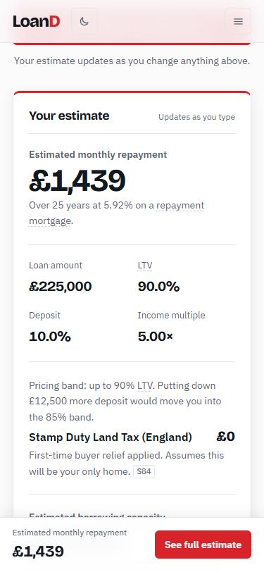
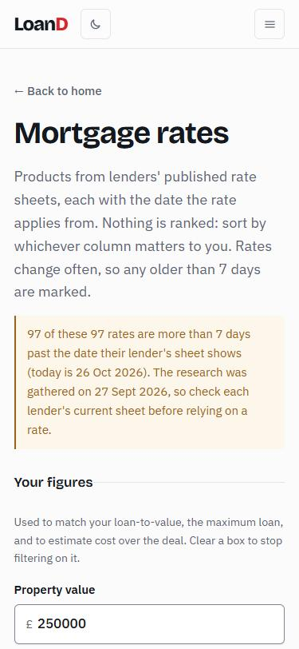
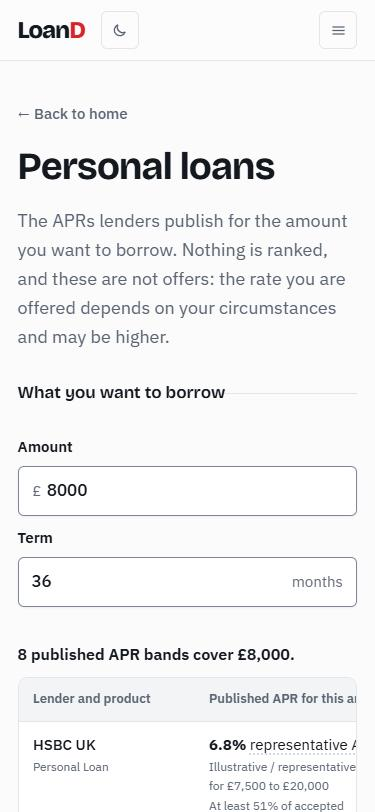
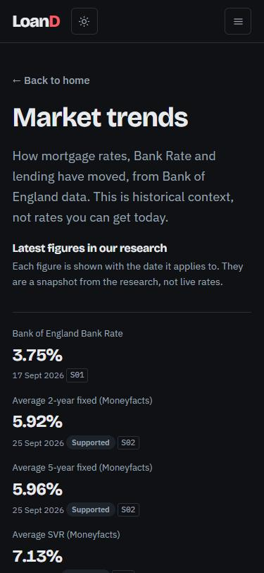

# LoanD

A UK website that helps people **estimate** whether their figures fall within
mainstream lenders' **published** mortgage and personal loan limits, and
**compare** what lenders publish side by side: rates, criteria, fees, and how
current each figure is.

LoanD is a fintech portfolio project. It is **not a lender, broker or adviser**.
It never says you "will be approved", never ranks or scores lenders, and
nothing on it is financial advice or an offer of credit. Check with the lender
or an FCA-authorised adviser before you apply.

Every fact carries a source code (for example `S13`) linking back to the lender,
regulator or government page it came from, a status saying how well it is
confirmed, and a date.

| Estimate | Rates | Loans | Market (dark mode) |
|---|---|---|---|
|  |  |  |  |

The screenshots are phone-width, taken on 26 October 2026. The rates warning is
real: the research was gathered on 27 September 2026, so every rate is past the
7-day freshness limit and says so.

## What it does

- **Mortgage calculator** (`mortgage.html`): monthly repayment (repayment or
  interest-only), loan-to-value, income multiple, purchase tax (SDLT, LBTT, LTT,
  including first-time buyer relief and the higher rates for additional homes),
  what-if scenarios, and a check of your figures against each lender's published
  rules, with the specific rule, value, status and source behind every result.
  Also shows each lender's indicative maximum borrowing from its published caps.
- **Mortgage rates** (`rates.html`): filterable, sortable table of products with
  APRC, product fee, early repayment charge, maximum loan, incentives, an
  estimated cost over the deal, and a stale badge on any rate more than 7 days
  past its date.
- **Personal loans** (`loans.html`): the APR bands lenders publish for your
  amount, with estimated payments.
- **Lenders and Compare** (`lenders.html`, `lender.html`, `compare.html`):
  published criteria, up to three lenders side by side.
- **Market** (`market.html`): Bank of England history, always labelled
  historical, with a data table behind each chart.
- **Data and methodology** (`methodology.html`): the release, status labels,
  sources, what is not published, unresolved conflicts, and how estimates work.

## Running it

Open `index.html` in a browser. There is no server and nothing is sent anywhere:
everything is worked out in your browser. For a local preview server, run
`node scripts/serve.js` and open http://localhost:4173.

A build step is only needed when the research workbook changes (see below).

## Updating the research data

All lender facts come from one research workbook
(`tools/Loand_UK_Lender_Research_<date>.xlsx`). The site never hand-edits a
fact. To use a new release, drop the new workbook into `data/` or `tools/` and run
(needs [Node.js](https://nodejs.org) 20 or later):

```
npm install
npm run build-data
```

The build validates the workbook first and stops with a clear message if a
required column is missing, a Source ID isn't in `Sources`, a status isn't one
of the six labels, a numeric column holds text, or a date isn't `YYYY-MM-DD`.
Known workbook defects are printed as warnings; `npm run build-data:strict`
makes them fail the build.

Output: `data/json/<sheet>.json` (one file per sheet), `data/json/meta.json`
(release date, row counts, source count), `data/meta.js` (release date only)
and `data/research.js` (the bundle the pages load today). Never edit these by
hand: fix the spreadsheet and re-run. Do not rename sheets or columns.

After a new release, re-check `GENERAL_CONDITION_RULES` in
`js/engine/rules.js`. It lists the rule IDs reviewed as applying to ordinary
cases; unreviewed rules are treated as special routes and never used to judge
someone's figures.

## Tests

```
npm test
```

Uses Node's built-in test runner; no extra packages. It covers the data
validator, the rule engine, calculators, rate and loan helpers, and the colour
contrast of both themes. Fixtures come from the official worked examples (for
example SDLT on £295,000 is £4,750; LBTT on £875,000 is £63,350; LTT on £280,000
is £3,300) and from real rows of the `Rules_Numeric` sheet. A GitHub Actions
workflow (`.github/workflows/ci.yml`) rebuilds the data, checks the generated
files are up to date, and runs the tests on every push.

## Data handling rules

Deliberate, and worth keeping:

- Only `CONFIRMED` rules decide whether figures fall within a lender's limits.
  `SUPPORTED` and `UNCONFIRMED` rules are shown as "check with the lender".
- `OUTDATED` rows are kept for the record but never shown as facts.
- `NOT VERIFIED` means "we could not retrieve it", never "not offered".
- Missing values show as "Not published" or "Not verified", never a guess or a zero.
- Rates more than 7 days past their effective date (or, where a lender's page
  shows none, the date we checked) are badged "May be out of date".
- Mortgages and personal loans are kept apart; historical data is never
  labelled as current; official and third-party sources are labelled.
- No lender is scored or ranked. Sorting is by a column the user chooses.
- Approval and acceptance rates are shown as "not publicly disclosed", never estimated.
- All research text is escaped before it reaches the page.
- Rates that undercut the same lender's own smaller-loan bands are marked
  "check", never hidden. Mortgage rates should rise as loan-to-value rises, so a
  reversal usually means the research couldn't separate two product segments.

## Structure

**Every filename in this project is unique.** Two files with the same name in
different folders get confused with each other the moment they're downloaded or
moved. Keep it that way.

```
Loand/
├── index.html, mortgage.html, rates.html, loans.html, lenders.html,
│   lender.html, compare.html, market.html, methodology.html
├── style.css               one shared stylesheet (light and dark themes)
├── script.js               shared helpers: formatting, sources, glossary, theme, navigation
├── js/
│   ├── engine/             pure, tested logic (runs in the browser and in Node)
│   │   ├── rules.js        checks figures against published rules; indicative maximum borrowing
│   │   ├── calc.js         repayments, purchase taxes, stress rates, scenarios
│   │   ├── rates.js        rate filtering, freshness, cost over the deal
│   │   └── loans.js        loan APR bands and payments
│   ├── vendor/             Chart.js 4.4.1 (MIT) with its licence; hash pinned by a test
│   └── *.js                page code that reads forms and draws results
├── data/
│   ├── research.js, meta.js, json/   GENERATED from the workbook: do not edit
│   ├── lender-registry.js  lender IDs, brand grouping, summaries (hand-written)
│   └── glossary.js         plain-English definitions for jargon
├── scripts/                build-data.js (workbook -> data/), serve.js (local preview)
├── tests/                  Node test runner
├── tools/                  the research workbook and the GitHub helper scripts
└── docs/                   research report, database notes, screenshots, original sketch
```

Scripts load in a fixed order on every page: data, then the engine files, then
`script.js`, then the page's own file.

## Putting it online

The site is plain static files, so any static host works. The simplest free
option is **GitHub Pages**, served straight from this repository. The repository
is at https://github.com/adibmolla-rgb/Loand; after pushing, switch Pages on
under Settings, Pages, "Deploy from a branch", branch `main`, folder `/ (root)`,
and the site goes live at https://adibmolla-rgb.github.io/Loand/. Nothing is
switched on until you do it. Vercel or Netlify would also work: point them at the
repository root with no build command, because the generated data is committed.

Helper scripts for the command line (they need
[Git](https://git-scm.com/downloads) and the
[GitHub CLI](https://github.com/cli/cli#installation); on Windows run them from
Git Bash rather than PowerShell):

```
bash tools/setup-github.sh                        # new repository (refuses if one exists)
bash tools/push-to-existing.sh your-name/loand    # repository that already exists; asks before pushing
bash tools/deploy.sh "what you changed"           # commit, push and rebuild data if a newer workbook is present
```

## Roadmap

Built in stages.

- **Now:** static HTML, CSS and JavaScript, with a self-hosted copy of Chart.js for the market charts.
- **Next:** shareable results using only non-personal inputs (to be discussed
  first), save and compare up to three scenarios in the browser, and a script
  that diffs two workbook releases using the `Changelog` sheet.
- **Later:** Node/Express backend and PostgreSQL replacing the generated data
  files (tables mirroring the JSON: lenders, rules_numeric, mortgage_rates,
  loan_apr_tiers, property_taxes, time_series, sources, conflicts), and an AI
  assistant that answers from the same published data.

## Known limitations

- The workbook has a defect: some `Lender_Overview` detail cells read
  "t verified" instead of "Not verified". The build warns about it; it needs
  fixing in the workbook.
- The pages still load their fonts from Google Fonts. Everything else, including
  Chart.js, is served from this repository.
- The engine doesn't model part-and-part repayment, or Virgin Money's
  "also applies to self-employed" income-multiple rule.
- Purchase-tax surcharges have no minimum price, because the workbook states none.
- Accessibility has been checked with the keyboard, automated contrast tests and
  a 360px layout scan, but not yet with a screen reader or in several browsers.

## Disclaimer

LoanD gives estimates and research for guidance only. It is not a lender, broker
or adviser, and nothing on this site is financial advice or an offer of credit.
Whether you can borrow is each lender's decision, using criteria that can
change. Check with the lender or an FCA-authorised adviser before you apply.

## Licence

[MIT](LICENSE). The research workbook is gathered from the public sources it
cites; check each source's own terms before reusing its content.
